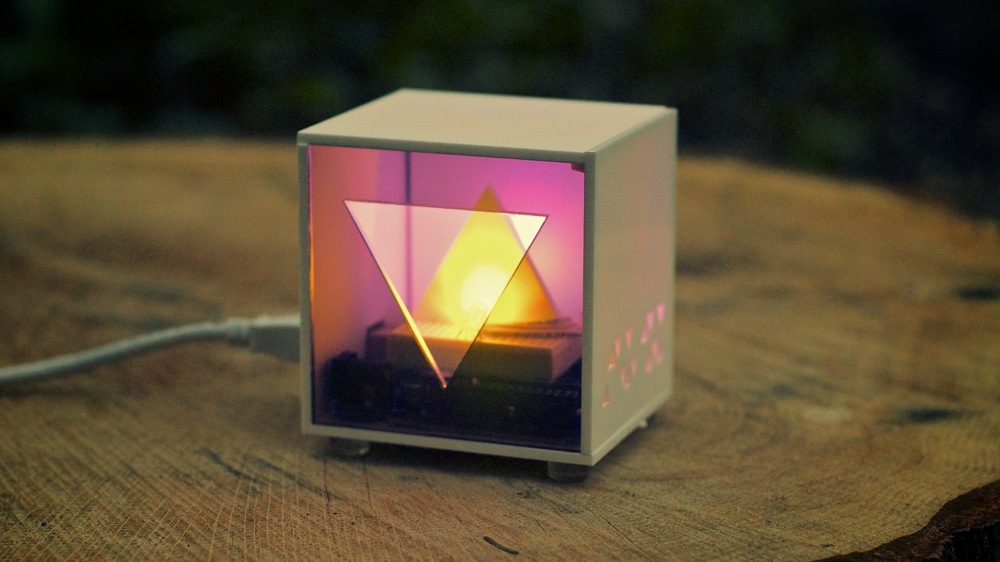

# Final Project: Complete Capstone Submission & Exhibition

- **Exhibition & Critique**: Wednesday, December 09, 2026 at 7:00 PM (Week 15)
- **Points**: 150 Points
- **Submission Type**: In-Person Demonstration + Online Documentation Submission (Learning Portfolio link + ZIP archive)

---

## Overview

The final exhibition is the culmination of your work in **Device Art**. You will present a fully functioning, beautifully crafted physical electronic object that unites concept, mechanism, interaction design, and aesthetic fabrication.

During class on December 09, our studio will be transformed into an exhibition. You will install your device, demonstrate its interactive behaviors live to peers and visiting critics, and participate in a final critique.

Prior to the start of class, you will submit your complete documentation package to Canvas and publish your comprehensive capstone post on your **Learning Portfolio**.

Refer to the master [Final Project Overview & Roadmap](../pages/final_project_overview.md) for full reference materials and the [Fabrication & Enclosure Resources Hub](../pages/fabrication.md) for laser cutting and soldering guides.

---

## Example Capstone Artifact

*Example of a completed, self-contained physical capstone device exhibiting intentional laser-cut acrylic joinery, clean internal soldered wiring, secure component mounting, and responsive interaction.*

---

## Submission Deliverables

Your complete final submission encompasses five core components:

### 1. In-Person Working Device (Exhibition & Critique)
* A fully integrated, functional physical artifact operated by a Raspberry Pi Pico.
* Beautifully finished enclosure using intentional materials (acrylic, wood, 3D printed resin/filament, metal, or modified readymades).
* Clean cable management and reliable power (USB power bank, enclosed battery, or dedicated power adapter).
* Intuitive tactile affordances that allow visitors to engage with the device without instruction.

### 2. Learning Portfolio Capstone Post
A comprehensive public documentation article containing:
* **Project Title & Subtitle**: An evocative title framing the work.
* **Artist Statement & Concept**: An articulate 2–3 paragraph statement explaining the conceptual inquiry, poetic utility, or cultural critique embedded in the device.
* **User Interaction Narrative**: A detailed walkthrough of how a user interacts with the piece and how it responds.
* **Process Retrospective**: A narrative documenting your design evolution from initial sketches and breadboard experiments through final fabrication, including photos of failed iterations and key technical breakthroughs.

### 3. Demonstration Video
* A high-quality video (1 to 2 minutes) demonstrating the device operating in real time.
* Show the object from multiple angles, highlighting craftsmanship, material details, and responsive feedback (lighting sequences, display screens, sounds, tactile inputs).
* Embed the video directly in your Learning Portfolio post (via YouTube, Vimeo, or HTML5 video) and submit the raw file or link to Canvas.

### 4. Technical Documentation Archive (GitHub & Canvas)
Submit a ZIP archive or GitHub repository link containing:
* **Firmware (`code.py`)**: Complete, clean, well-commented CircuitPython code running on the device.
* **Circuit Schematic**: Final, clean schematic showing all pinouts, power distribution, and components.
* **Mechanical Drawings & 3D CAD**: All vector cut files (SVG/DXF) and 3D models (STEP/STL) used in fabrication.
* **Final Bill of Materials (BOM)**: Completed table listing all parts, vendors, costs, and dimensions.

### 5. High-Resolution Studio Photography
* At least **4 high-resolution, well-lit photographs**:
  1. *Hero View*: Isometric/front shot of the device in its intended environment.
  2. *Detail View*: Close-up of tactile controls, labeling, and screen/LED feedback.
  3. *Craftsmanship / Joinery View*: Highlighting material transitions, fasteners, and edge finishes.
  4. *In-Use View*: Capturing human hands interacting with the device.

---

## Evaluation Rubric

| Criteria | Description | Points |
| :--- | :--- | :---: |
| **Conceptual & Artistic Depth** | Distinct artistic vision where the mechanism is the concept; playful, critical, or poetic utility that transcends simple gadgetry. | 40 |
| **Interactive & Electronic Reliability** | Flawless physical interaction; inputs read responsively, outputs communicate clearly, and code runs robustly without crashing. | 40 |
| **Craftsmanship & Material Fabrication** | High level of fabrication quality; intentional material choices, clean joinery, secure internal mounting, and polished surface finishing. | 40 |
| **Comprehensive Documentation** | Exemplary Learning Portfolio post, professional demonstration video, complete technical archive (BOM, code, schematics, CAD). | 30 |
| **Total** | | **150** |
