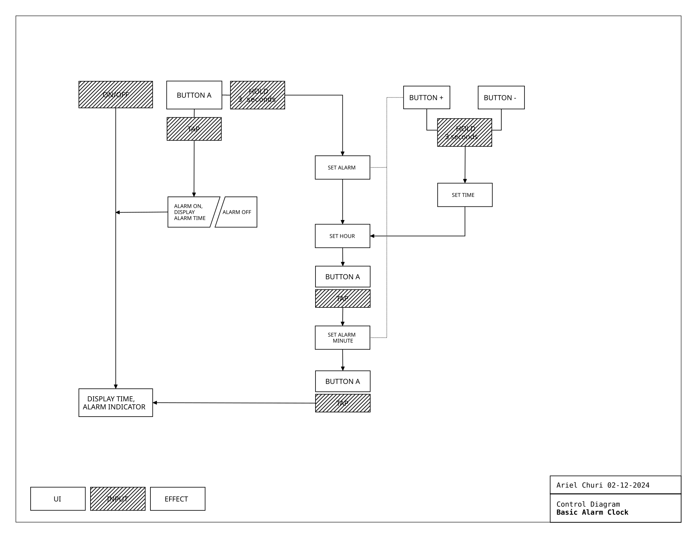
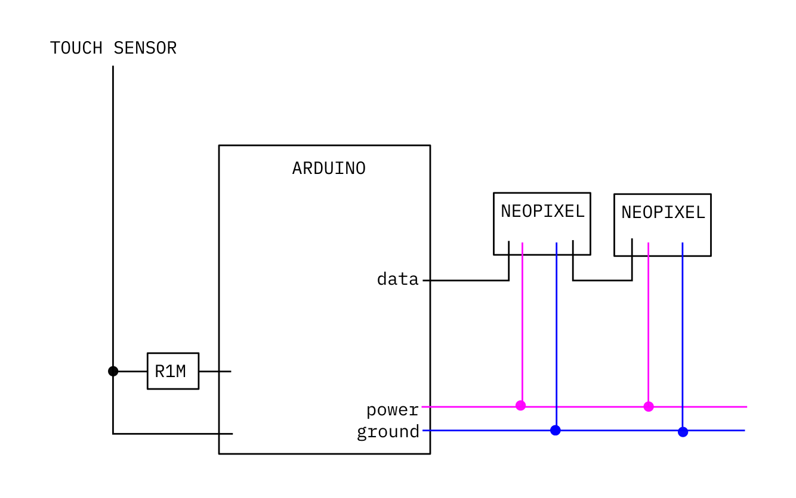

# Final Project Milestone 2: Functional Diagram, Pseudo-Code & Benchtop Circuit

- **Due Date**: Wednesday, November 04, 2026 at 7:00 PM (Week 11)
- **Points**: 50 Points
- **Submission Type**: Link to learning portfolio posts.

---

## Overview

In Milestone 2, you transition from concept to functional system architecture. Before cutting materials or designing complex enclosures, you must build and verify your electronic subsystem on a solderless breadboard and map its logic.

By the end of this milestone, your Raspberry Pi Pico will be running working CircuitPython code that reads your core inputs (buttons, rotary encoders, capacitive touch sensors, distance sensors) and drives your outputs (OLED/LCD displays, Neopixels, PWM buzzers, servos).

Refer to the master [Final Project Overview & Roadmap](../pages/final_project_overview.md) for full context and overarching schedule.

---

## Example References & Deliverables

### 1. Functional Diagram (System State Machine)
Your functional diagram outlines user actions, controller states, and sensory outputs:



### 2. Firmware Pseudo-Code Example
Map the primary loop and state machine in plain language before writing CircuitPython:

```text
Initialize Pico hardware:
  Configure OLED SSD1306 on I2C bus (GP4/GP5)
  Configure DS3231 Real-Time Clock on secondary I2C
  Configure Capacitive Touch Sensor on GP16
  Configure Neopixel ring (12 LEDs) on GP15

Primary Loop (runs continuously):
  Update current_time from time.monotonic()
  
  Read Touch Sensor:
    If touch detected and state is IDLE:
      Record trigger_time = current_time
      Transition state to ACTIVE_SCAN
      Illuminate Neopixels with golden chase sequence
      Display animation frame on OLED
      
  If state == ACTIVE_SCAN:
    If current_time - trigger_time > 5.0 seconds:
      Read temperature / RTC timestamp
      Format message buffer
      Print outcome to OLED display
      Fade Neopixels to resting breathe pulse
      Transition state to DISPLAY_RESULT
      
  If state == DISPLAY_RESULT:
    If current_time - trigger_time > 15.0 seconds:
      Clear display
      Transition state back to IDLE
```

### 3. Circuit Wiring Schematic Example
A clear diagram detailing every pin connection, pull-up/pull-down resistor, and power line:



---

## Prototyping Progression: Breadboard to Soldered Circuit

Milestone 2 requires a working benchtop circuit on a **solderless breadboard** to rapidly verify sensor communication and firmware timing. 

As you plan for Milestone 3 (Enclosure Fit) and final assembly:
- Temporary jumper wires are prone to disconnecting inside an enclosure.
- In later milestones, you will transition critical connections to permanent **soldered perfboards, perma-proto boards, or soldered header wires** with heat-shrink tubing and cable strain relief.
- Soldering stations, fume extractors, wire strippers, and bench equipment are available at the **Parsons Making Center AMT E-Lab** (63 Fifth Ave and 2 W 13th St). Check [Fabrication Resources](../pages/fabrication.md) for facility hours and tool catalogs.

---

## Required Deliverables

### 1. Functional Diagram (Block Diagram / State Machine)

A clear graphic diagram describing the operational architecture of your device:

- **System Inputs**: Every sensor, switch, dial, or communication channel.
- **Controller Logic & States**: Distinct operating states (e.g., `STANDBY`, `SENSING`, `PROCESSING`, `ALERT`, `SLEEP`) and the exact conditions that cause transitions between them.
- **System Outputs**: Visual, auditory, or mechanical feedback tied to each state.
- _File format_: Vector SVG, PNG, or PDF (created in LibreOffice Draw, Draw.io, Illustrator, or similar).

### 2. Firmware Pseudo-Code

A structured plain-text outline of your code logic before implementation:

- Hardware pin assignments and variable declarations.
- Setup routines (I2C bus initialization, sensor calibration, display greeting).
- Main loop logic with explicit non-blocking timing structures (`time.monotonic()`) rather than blocking `time.sleep()`.
- State transition rules.

### 3. Benchtop Working Circuit (`code.py` & Breadboard)

Assemble your complete circuit on a solderless breadboard powered by your Raspberry Pi Pico:

- Wire all primary sensors, displays, and actuators.
- Maintain clean jumper routing so individual signals can be probed and tested with your multimeter.
- Write working CircuitPython firmware (`code.py`) executing your core interaction loop.
- Verify reliable Serial REPL output for troubleshooting.

### 4. Circuit Schematic & Demonstration Video

- **Circuit Diagram**: A clean schematic or wiring graphic showing every GPIO pin, VBUS/3V3 power rails, ground connections, and pull-up/pull-down resistors.
- **Demonstration Video**: A short video (30–60 seconds, MP4/MOV or unlisted YouTube/Vimeo link) showing you interacting with the breadboard circuit and demonstrating state transitions in real time.

---

## Evaluation Rubric

| Criteria                            | Description                                                                                    | Points |
| :---------------------------------- | :--------------------------------------------------------------------------------------------- | :----: |
| **Functional Diagram Clarity**      | Thorough mapping of all states, input events, transitions, and corresponding outputs.          |   15   |
| **Circuit Functionality & Wiring**  | Clean breadboard wiring; all inputs read reliably and outputs respond accurately.              |   15   |
| **Firmware Quality (`code.py`)**    | Well-structured, commented CircuitPython code using non-blocking timing and clear state logic. |   10   |
| **Schematic & Demonstration Video** | Clear schematic diagram and video showing the working benchtop circuit in action.              |   10   |
| **Total**                           |                                                                                                | **50** |
