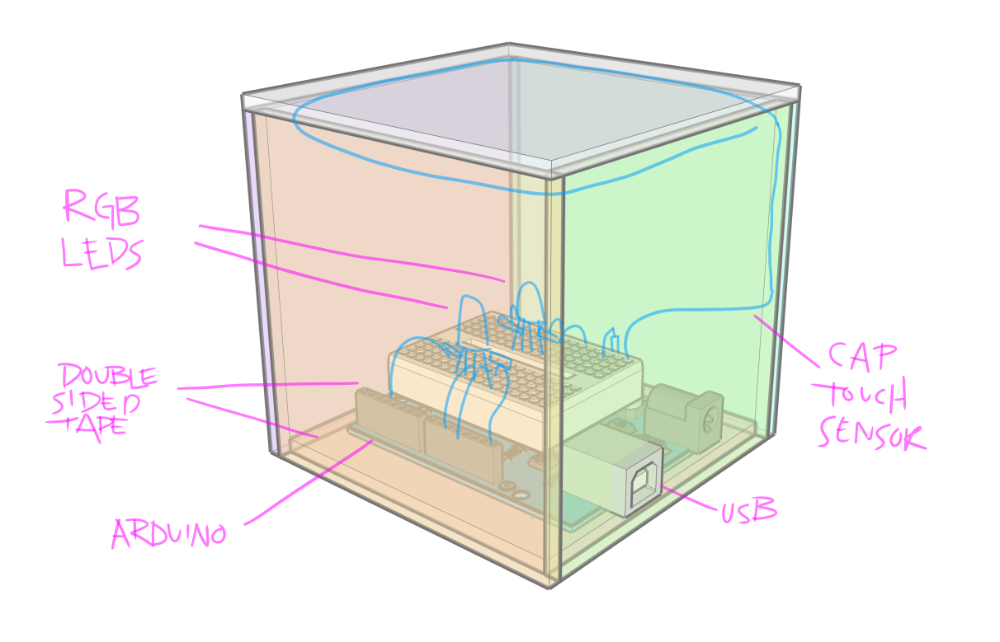
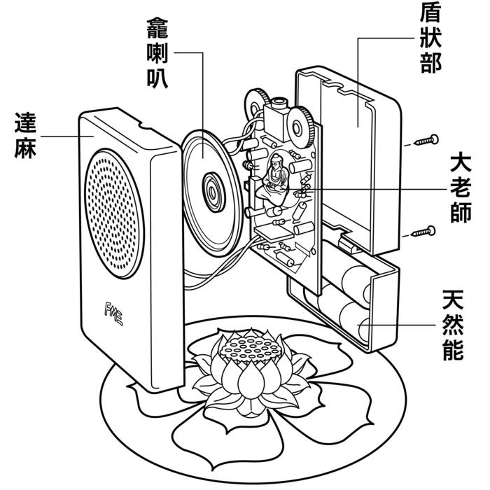

# Final Project Milestone 3: Mechanical Drawing & Enclosure Mockup

- **Due Date**: Wednesday, November 11, 2026 at 7:00 PM (Week 12)
- **Points**: 50 Points
- **Submission Type**: Online File Upload (Drawings, CAD Files, Photos) or URL (GitHub/Documentation link)

---

## Overview

In Milestone 3, your device takes physical form. An interactive device must possess structural integrity, ergonomic tactile qualities, and precise internal mounting for electronic components.

You will produce dimensioned mechanical drawings and fabricate a rapid physical prototype of the enclosure (using laser-cut cardboard/acrylic, 3D printing, or benchtop joinery). This mockup will verify that your circuit, display, sensors, tactile switches, and battery/USB cables physically fit and function together.

Refer to the master [Final Project Overview & Roadmap](../pages/final_project_overview.md), the [Cardboard Engineering Guide](../pages/cardboard_engineering_guide.md), and the [Fabrication & Enclosure Resources Hub](../pages/fabrication.md) for techniques and specifications.

---

## Example References & Drawings

### 1. Dimensioned Mechanical Drawings
Your mechanical drawing communicates outer panel dimensions, joinery, and internal component mounting:

*Downloadable vector reference:* [mechanical-m.svg](../files/images/final_project/mechanical-m.svg) | [example_mech_drawing.svg](../../meta/pedagogy_and_notes/final_object/mechanical_drawing/example_mech_drawing.svg)

---

## Digital Fabrication & Laser Cutting Standards

When preparing 2D vector files (Illustrator or Inkscape) for laser cutting on Universal Laser Systems machines at the **Parsons Making Center**:

- **Color Mode**: Set document color space to **RGB**.
- **Stroke Weight**: Set stroke width to **0.001 pt** (hairline) for all vector lines.
- **Color Coding**:
  - **Vector Cut (Through-cut)**: RGB Red (`#FF0000`, R: 255, G: 0, B: 0)
  - **Vector Score (Engrave line without cutting through)**: RGB Blue (`#0000FF`, R: 0, G: 0, B: 255)
  - **Raster Etch (Surface shading/fill)**: RGB Black (`#000000`, R: 0, G: 0, B: 0)
- **Reference Guides**:
  - [Illustrator Universal Laser Guide (PDF)](../files/cheatsheets/Illustrator-Universal-Laser-Guide-2025.pdf) — Complete guide for laser setup and color formatting.
  - [MoodLight Laser Cut Pattern (`moodlight_laserpattern.svg`)](../assignments/moodlight/moodlight_laserpattern.svg) — Sample vector cut layout showing panel standoffs and sensor windows.
  - [Parsons E4 Laser Lab Store](https://epay.newschool.edu/C21120_ustores/web/store_main.jsp?STOREID=56) & [Canal Plastics Center](https://www.canalplastic.com/) (345 Canal St, NYC) for acrylic sheet stock and solvent cement.

---

## Circuit Integration & Soldering Preparation

As you test-fit your hardware into the enclosure:
- **Component Clearance**: Account for the physical depth of components behind panels (e.g., potentiometer bodies, buttons, OLED headers).
- **Strain Relief & Wire Routing**: Route wires so they cannot be pinched when closing the enclosure. Plan wire lengths allowing the enclosure to open for servicing.
- **Transition to Solder**: Breadboard jumper wires will come loose inside an enclosed device. Plan out how components will be wired to perfboard or soldered directly to header leads with heat-shrink insulation.

---

## Required Deliverables

### 1. Dimensioned Mechanical Drawings (Vector or CAD)
Produce detailed mechanical drawings specifying every panel, cutout, and internal mounting boss:
* **Overall Dimensions**: Width, height, and depth indicated with dimension lines and units (millimeters or inches).
* **Component Cutouts & Bezels**: Precise apertures for your OLED/LCD display screen, pushbuttons, potentiometers, sensor sightlines, and power switches.
* **Cable & Port Access**: Cutouts for USB programming/power entry and battery compartment access.
* **Joinery & Assembly Strategy**: Clear indications of how panels join (finger joints, T-slots for captive nuts, screw bosses, snap-fits, or living hinges).
* *File formats*: Vector SVG/DXF (Inkscape / Illustrator) or CAD export (Fusion 360 / Blender STEP/STL/PDF).

### 2. Rapid Physical Enclosure Prototype
Fabricate a physical test model to validate your dimensions and tolerances:
* **Material**: Cardboard, draftboard/MDF, scrap acrylic, or rapid FDM 3D print.
* **Test Fit**: Mount your actual physical hardware (switches, display, Pico, sensors) into their designated openings.
* **Tolerances**: Verify that buttons depress freely without binding, screens sit flush, and wires route cleanly without pinching.

### 3. Documentation Photos & Tolerance Reflection
Upload at least **3 clear photographs**:
1. **Overall Form**: An isometric view showing the completed physical enclosure mock-up.
2. **Component Integration**: A close-up showing buttons, screen, and sensors mounted in place.
3. **Internal Layout**: A view of the open interior showing wire routing and component clearance.
* **Brief Written Note**: Describe what fit perfectly, what dimensions need adjustment for the final production run, and which final materials will be used in Week 13–14.

---

## Evaluation Rubric

| Criteria | Description | Points |
| :--- | :--- | :---: |
| **Mechanical Drawing Precision** | Accurate, dimensioned vector or CAD drawings showing all cutouts, tolerances, and joinery. | 20 |
| **Physical Fit & Ergonomics** | Successful physical mockup; hardware components seat properly and interface feels intentional in the hand. | 20 |
| **Tolerance Evaluation & Refinement Plan** | Honest analysis of fit, wire routing, and a clear plan for final material fabrication. | 10 |
| **Total** | | **50** |
