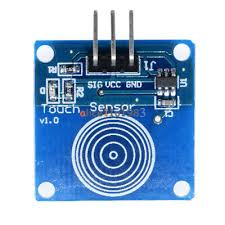

# TTP223 / TTP223B Capacitive Touch Sensor

The TTP223 is a capacitive touch sensor that can detect human touch through up to 3–5 mm of acrylic, wood, or plastic. It acts as an invisible, solid-state electronic button.



---

## 1. Technical Datasheets & Dimensional Guides

- **Dimensional & Solder Jumper Guide:** [ttp223-touch-sensor.pdf](ttp223-touch-sensor.pdf) (High-precision mechanical drawing: 15×11mm mini PCB footprint, Ø8.0mm touch pad, and rear solder jumper configuration matrix).
- **Official IC Datasheet:** [TTP223.pdf](TTP223.pdf) (Tontek 1-Key Touch Pad Detector IC engineering specifications).

---

## 2. Solder Jumper Configurations (A & B Pads)

On the back of the red module are two pairs of solder pads labeled **A** and **B**. By default, both are open.

| Jumper A | Jumper B | Operational Mode | Output Behavior |
| :---: | :---: | :--- | :--- |
| **Open** | **Open** | **Momentary (Direct)** *(Default)* | Outputs **LOW**, goes **HIGH** when touched |
| **Short**| **Open** | **Momentary Inverted** | Outputs **HIGH**, goes **LOW** when touched |
| **Open** | **Short**| **Toggle (Latching)** | Toggles state between HIGH and LOW on each touch |
| **Short**| **Short**| **Toggle Inverted** | Toggles state between LOW and HIGH on each touch |

---

## 3. Wiring to Raspberry Pi Pico

Connect the 3-pin header to power and any digital GPIO pin:
- **VCC** $\rightarrow$ `3V3` (Pin 36) or `VBUS` (5V)
- **GND** $\rightarrow$ `GND` (Pin 38)
- **I/O** or **SIG** $\rightarrow$ Any Pico digital input (e.g. `GP14`)

---

## 4. CircuitPython Example

The sensor acts as a digital input (no external pull-up resistor needed, as the module drives the line actively).

```python
import time
import board
import digitalio

touch = digitalio.DigitalInOut(board.GP14)
touch.direction = digitalio.Direction.INPUT

print("TTP223 Capacitive Touch Ready...")

while True:
    if touch.value:
        print("TOUCH DETECTED!")
        time.sleep(0.15)  # Brief debounce delay
    time.sleep(0.02)
```
