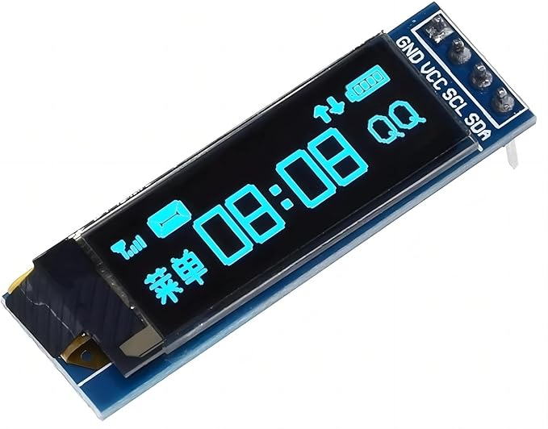
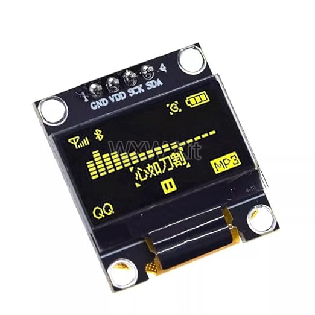
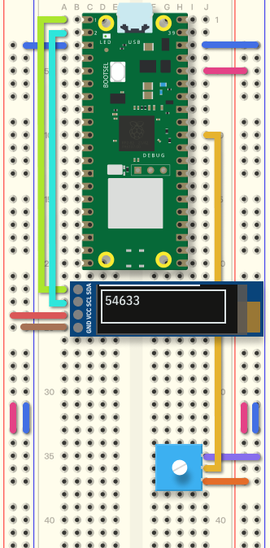
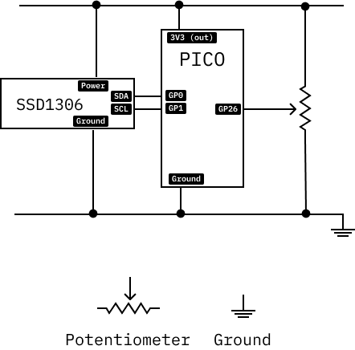

# Display (SSD1306 OLED)

SSD1306 OLED displays are small, high-contrast, and inexpensive. They communicate with the Raspberry Pi Pico over I2C (default address `0x3C`).

 

---

## Required Libraries

To use the SSD1306 display with text labels in CircuitPython, copy **both** of the following into the `lib/` folder on your `CIRCUITPY` drive:

1. **[adafruit_displayio_ssd1306.mpy](adafruit_displayio_ssd1306.mpy)** — The hardware display driver.
2. **[adafruit_display_text](adafruit_display_text/)** (folder) — Required for rendering text and labels (`from adafruit_display_text import label`).

*Both libraries can also be downloaded directly from the official [CircuitPython Library Bundle](https://circuitpython.org/libraries).*

---

## Example 1: Displaying Text and Potentiometer Values

In this example, the live analog value of a potentiometer on `GP26` is rendered on the screen.

```python
# SPDX-FileCopyrightText: 2021 ladyada for Adafruit Industries
# Small edits for Raspberry Pi Pico by Ariel Churi
# SPDX-License-Identifier: MIT

"""
This test will initialize the display using displayio and draw a solid white
background, a smaller black rectangle, and some white text.
"""

import board
import busio
import displayio

# For the potentiometer.
import analogio
potentiometer = analogio.AnalogIn(board.GP26)

from i2cdisplaybus import I2CDisplayBus

import terminalio
from adafruit_display_text import label
import adafruit_displayio_ssd1306

displayio.release_displays()

i2c = busio.I2C(board.GP1, board.GP0)  
display_bus = I2CDisplayBus(i2c, device_address=0x3C)
display = adafruit_displayio_ssd1306.SSD1306(display_bus, width=128, height=32)

# Make the display context
splash = displayio.Group()
display.root_group = splash

color_bitmap = displayio.Bitmap(128, 32, 1)
color_palette = displayio.Palette(1)
color_palette[0] = 0xFFFFFF  # White

bg_sprite = displayio.TileGrid(color_bitmap, pixel_shader=color_palette, x=0, y=0)
splash.append(bg_sprite)

# Draw a smaller inner rectangle
inner_bitmap = displayio.Bitmap(118, 24, 1)
inner_palette = displayio.Palette(1)
inner_palette[0] = 0x000000  # Black
inner_sprite = displayio.TileGrid(inner_bitmap, pixel_shader=inner_palette, x=5, y=4)
splash.append(inner_sprite)

# Draw a label
text = "Hello World!"
text_area = label.Label(terminalio.FONT, text=text, color=0xFFFF00, x=28, y=15)
splash.append(text_area)

while True:
    text_area.text = str(potentiometer.value)
```

### Wiring Diagrams





---

## Example 2: Displaying Images on the Screen

CircuitPython displays images using `displayio.OnDiskBitmap`. This streams bitmap graphics directly from the board's flash storage into the display buffer without consuming large amounts of microcontroller RAM.

See the complete example script: [display_image.py](display_image.py)

### Image Format Requirements

CircuitPython requires bitmap files formatted to strict specifications:
- **Format**: Windows Bitmap (`.bmp`)
- **Color Depth**: **1-bit monochrome** (Indexed, exactly 2 colors: black and white)
- **Dimensions**: Must match your screen resolution (typically **128x32** or **128x64** pixels)

You can download a working sample bitmap here: [test_pattern.bmp](test_pattern.bmp)

#### Converting Images to 1-Bit BMP

**Option A: Using Python (Pillow) on your computer:**
```python
from PIL import Image

# Resize and convert to 1-bit monochrome
img = Image.open("my_artwork.png").convert("1").resize((128, 32))
img.save("image.bmp")
```

**Option B: Using ImageMagick in Terminal:**
```bash
magick input.png -resize 128x32\! -monochrome -depth 1 BMP3:image.bmp
```

**Option C: Using Photoshop or GIMP:**
1. Resize your canvas to `128x32` (or `128x64`).
2. Convert image mode to **Indexed** -> **1-bit (Black & White)**.
3. Export as `.bmp` (disable color space embedding).

Copy the resulting `.bmp` file into the root of your `CIRCUITPY` drive.

### Image Display Code

```python
import board
import busio
import displayio
from i2cdisplaybus import I2CDisplayBus
import adafruit_displayio_ssd1306

displayio.release_displays()

# Initialize I2C (Pico GP1=SCL, GP0=SDA)
i2c = busio.I2C(board.GP1, board.GP0)
display_bus = I2CDisplayBus(i2c, device_address=0x3C)
display = adafruit_displayio_ssd1306.SSD1306(display_bus, width=128, height=32)

# Load the 1-bit BMP from flash storage
bitmap = displayio.OnDiskBitmap("/image.bmp")

# Create a TileGrid and assign to root_group
tile_grid = displayio.TileGrid(bitmap, pixel_shader=bitmap.pixel_shader)
group = displayio.Group()
group.append(tile_grid)
display.root_group = group

while True:
    pass
```
