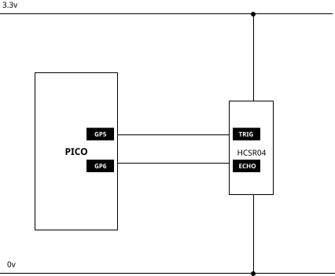

# Ultrasonic sensor

- [product page](https://learn.adafruit.com/ultrasonic-sonar-distance-sensors) There are new versions of this product.

---

## Technical Datasheets & Dimensional Guides

- **Dimensional & Enclosure Guide:** [hcsr04-ultrasonic-module.pdf](hcsr04-ultrasonic-module.pdf) (High-precision mechanical drawing: 45×20mm PCB outline, dual 16mm barrel cutouts spaced 26mm center-to-center, depth profile, and 3.3V logic protection note).
- **Electrical Datasheet:** [HCSR04.pdf](HCSR04.pdf) (HC-SR04 ultrasonic ranging module electrical parameters and timing diagrams).

---

You will need to drag the _adafruit_hcsr04.mpy_ library file into the _lib_ folder on your micro.

- [circuitPython library bundles](https://circuitpython.org/libraries)

- [adafruit learn page](https://learn.adafruit.com/ultrasonic-sonar-distance-sensors)

```python
import board
import time
import board
import adafruit_hcsr04  # the library
sonar = adafruit_hcsr04.HCSR04(trigger_pin=board.GP5, echo_pin=board.GP6)

# For the potentiometer.
while True:
    try:
        print(sonar.distance)
        my_distance = sonar.distance
    except RuntimeError: # remove the line and the next to see the output better.
        print("Retrying!")
    time.sleep(0.01)
```


