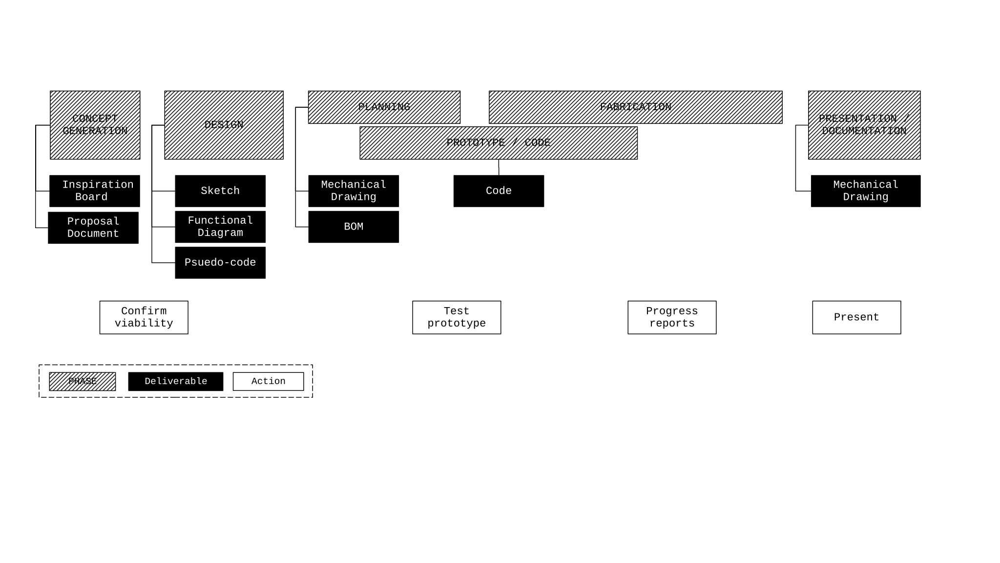
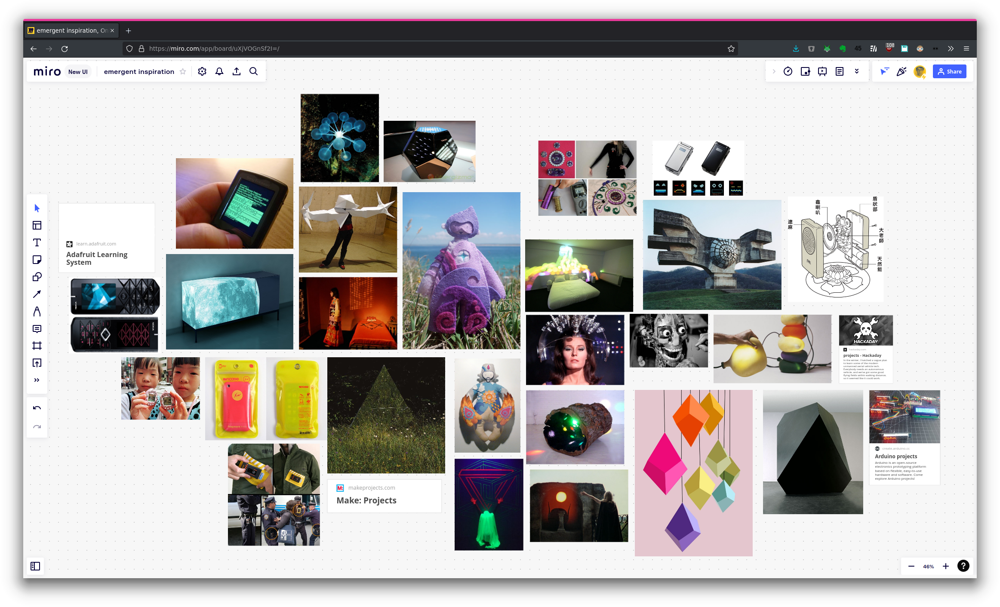

# Final Project: Device Art Capstone


## Project Overview

In this capstone project, you will design, engineer, and fabricate an original **Device Art** object—a self-contained, physical interactive device that unites concept, mechanism, interaction design, and aesthetic fabrication.

In *Device Art*, the object is not merely a container for technology or a utility gadget; **the mechanism itself is the concept, and the device is the artwork**. Through playfulness, ritual, critique, or poetic utility, your device will inhabit the fertile threshold between art, design, and engineering.

A complete submission encompasses four essential dimensions:
1. **Conceptual Realization**: Translating a distinct artistic intention or inquiry into a tangible physical reality.
2. **Interactive & Systemic Success**: Responsive, reliable physical interaction governed by a Raspberry Pi Pico running non-blocking CircuitPython.
3. **Craftsmanship & Aesthetic Presentation**: An intentional physical enclosure utilizing digital fabrication (laser cutting, 3D printing, CNC milling) and thoughtful material finishing.
4. **Comprehensive Documentation**: Clear communication of your creative evolution, mechanical drawings, electrical schematics, firmware, and user interaction.

---

## The Creation Process Roadmap

The diagram below maps the relationships between each milestone deliverable and the progressive phases of production. **Notice that the majority of foundational planning and system design happens in the first three weeks** so that physical fabrication and bench testing can proceed without structural bottlenecks.



---

## Master Deliverables Checklist

Keep this checklist active in your project notebook and GitHub repository:

- [ ] **1. Inspiration Board**: A curated [Miro](https://miro.com) board containing at least 20 visual references and 5 specific case studies.
- [ ] **2. Proposal Document**: A written brief outlining your working title, concept, human interaction narrative, technical unknowns, and artistic references.
- [ ] **3. Concept Sketches**: Hand-drawn or digital sketches exploring form factor, hand grip, control layout, and material finishes.
- [ ] **4. Functional Diagram**: A block diagram or finite state flowchart detailing the modes, inputs, transitions, and system feedback.
- [ ] **5. Pseudo-Code**: Plain-language step-by-step logic mapping the firmware behavior prior to coding.
- [ ] **6. Circuit Diagram & Wiring Schematic**: A clear diagram showing every pin connection between the Raspberry Pi Pico, sensors, actuators, displays, and power.
- [ ] **7. Mechanical Drawing & CAD Files**: Dimensioned vector cut files (SVG/DXF) or 3D models (STEP/STL) specifying enclosure geometry, internal supports, and tolerances.
- [ ] **8. Bill of Materials (BOM)**: A comprehensive table listing all raw materials, hardware fasteners, electronic parts, vendors, and costs.
- [ ] **9. Working Firmware (`code.py`)**: Robust, well-commented CircuitPython firmware using non-blocking timing (`time.monotonic()`) and state machines.
- [ ] **10. Final Documentation Post & Video**: A published *Learning Portfolio* entry featuring high-resolution photography, a working video demonstration, and a reflective post-mortem.

---

## Detailed Deliverable Specifications

### 1. Proposal Document & Inspiration Board
Your proposal is published to your **Learning Portfolio** and submitted via Canvas. It must articulate:
* **Working Title**: An evocative title for your device.
* **Concept Narrative**: What is this device? What cultural, speculative, or personal inquiry does it explore?
* **Interaction Loop**: Walk step-by-step through a user encounter: How is the object approached? What physical affordance cues the user? What is the sensory response (light, sound, motion, display)?
* **Technical & Material Unknowns**: What parts, fabrication techniques, or code libraries are you unsure about? How will you test them early?
* **Artistic & Historical Precedents**: At least 3 links to related artworks, historical instruments, or design artifacts.



*Create your board on [Miro](https://miro.com) and invite `churia@newschool.edu`. Include material swatches, mechanical movements, typography, and case studies.*

---

### 2. Functional Diagram (System State Machine)
A block diagram detailing how inputs trigger internal state changes and corresponding outputs.


*Tools: [LibreOffice Draw](https://www.libreoffice.org), [Draw.io](https://app.diagrams.net), or vector illustration tools.*

---

### 3. Firmware Pseudo-Code
Before writing CircuitPython, structure your logic in plain language. Map your primary loop, non-blocking timer checks, sensor thresholds, and state transitions:

```text
Initialize Pico hardware:
  Configure OLED SSD1306 on I2C bus (GP4/GP5)
  Configure DS3231 Real-Time Clock on secondary I2C
  Configure Capacitive Touch Sensor on GP16
  Configure Neopixel ring (12 LEDs) on GP15

Primary Loop (runs continuously):
  Update current_time from time.monotonic()
  
  Read Touch Sensor:
    If touch detected and state is IDLE:
      Record trigger_time = current_time
      Transition state to ACTIVE_SCAN
      Illuminate Neopixels with golden chase sequence
      Display animation frame on OLED
      
  If state == ACTIVE_SCAN:
    If current_time - trigger_time > 5.0 seconds:
      Read temperature / RTC timestamp
      Format message buffer
      Print outcome to OLED display
      Fade Neopixels to resting breathe pulse
      Transition state to DISPLAY_RESULT
      
  If state == DISPLAY_RESULT:
    If current_time - trigger_time > 15.0 seconds:
      Clear display
      Transition state back to IDLE
```

---

### 4. Mechanical Drawing & Digital Fabrication
A production document showing all critical dimensions, component apertures (switches, OLED bezels, sensor ports, USB cable entry), and wall joinery (finger joints, snap-fits, or screw bosses).


*Tools: [Inkscape](https://inkscape.org), Adobe Illustrator, Blender, or Autodesk Fusion 360.*

---

### 5. Circuit Diagram & Wiring Schematic
A clear schematic showing power distribution (5V vs 3.3V), pull-up/pull-down resistors, capacitor smoothing, and exact GPIO pin connections on the Raspberry Pi Pico.


---

### 6. Bill of Materials (BOM)
Track every single physical and electronic element of your build:

| Item | Component / Material | Specification / Color | Qty | Vendor / Source | Part Link | Unit Cost |
| :--- | :--- | :--- | :--- | :--- | :--- | :--- |
| 1 | Microcontroller | Raspberry Pi Pico (RP2040) | 1 | Course Kit | [Datasheet](../raspberryPiPico/pico-datasheet.pdf) | — |
| 2 | Display | SSD1306 0.96" OLED I2C | 1 | Course Kit | [Datasheet](../parts/display/ssd1306-oled-module.pdf) | — |
| 3 | Addressable LEDs | WS2812B Neopixel Ring 12x | 1 | Course Kit | [Datasheet](../parts/neopixel/WS2812B.pdf) | — |
| 4 | Enclosure Body | 1/8" (3mm) Matte Cast Acrylic | 1 | Canal Plastics | [Link](https://canalplastic.com) | $12.50 |
| 5 | Hardware Fasteners | M3 x 12mm Stainless Hex Screws | 8 | McMaster-Carr | [Link](https://mcmaster.com) | $4.20 |
| 6 | Secondary Sensor | TTP223 Capacitive Touch | 1 | Course Kit | [Datasheet](../parts/captouch_sensor/ttp223-touch-sensor.pdf) | — |

---

## Milestone Timeline (Weeks 09 – 15)

| Week | Date | Studio Focus | Milestone Due |
| :--- | :--- | :--- | :--- |
| **Week 09** | Oct 21 | Final Project Kickoff, Conceptual Ideation & Materials Exploration | In-Class Ideation |
| **Week 10** | Oct 28 | System Architecture & Prototyping Strategy | **Milestone 1**: Proposal, Miro Board & Initial BOM |
| **Week 11** | Nov 04 | Working Breadboard Circuit & Logic Verification | **Milestone 2**: Functional Diagram, Pseudo-code & Benchtop Circuit |
| **Week 12** | Nov 11 | Digital Fabrication & Enclosure Mockups | **Milestone 3**: Mechanical Drawings & First Physical Enclosure Fit |
| **Week 13** | Nov 18 | Systems Integration & Refinement | **Milestone 4**: Integrated Working Device in Enclosure |
| *Break* | *Nov 25* | *Thanksgiving Eve — No Class* | *Bench testing / Studio time* |
| **Week 14** | Dec 02 | Documentation Staging & Exhibition Rehearsal | Video Draft & Photography Critique |
| **Week 15** | Dec 09 | **Final Exhibition, Live Demonstration & Public Critique** | **Final Submission Package** (LP Post, Video, Code, Drawings) |
